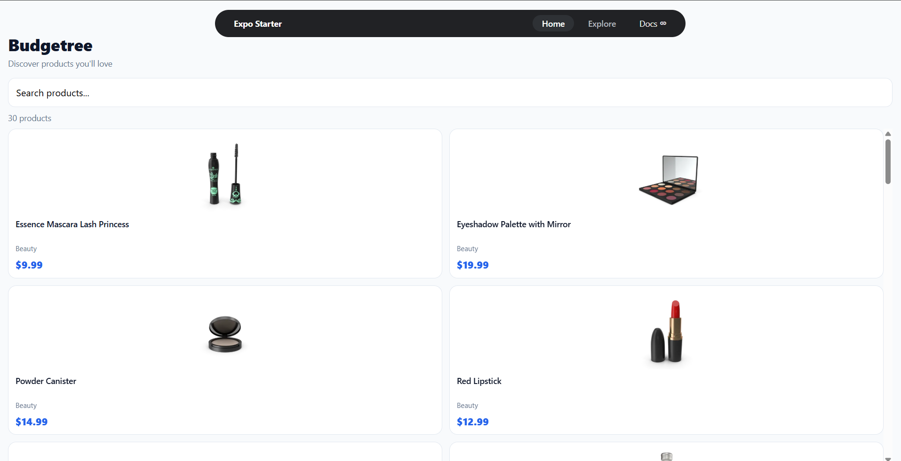
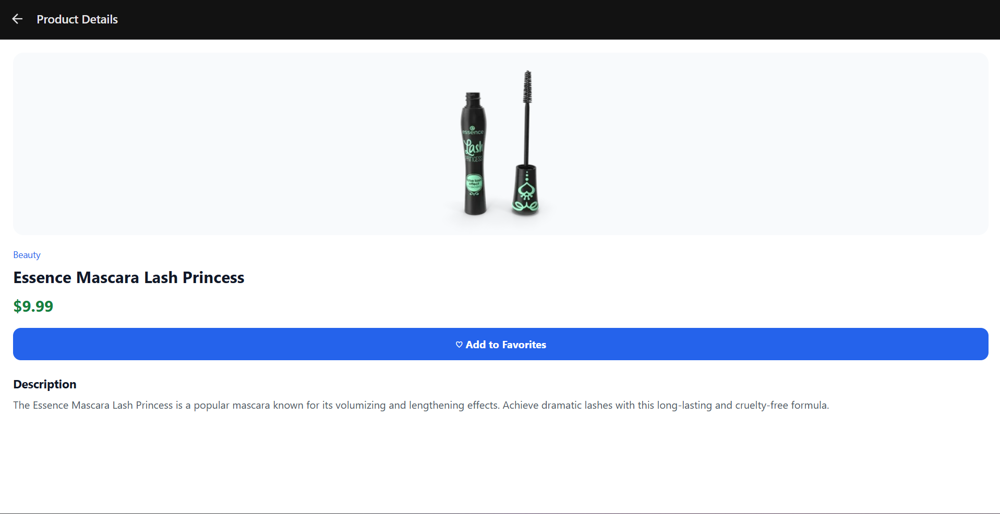
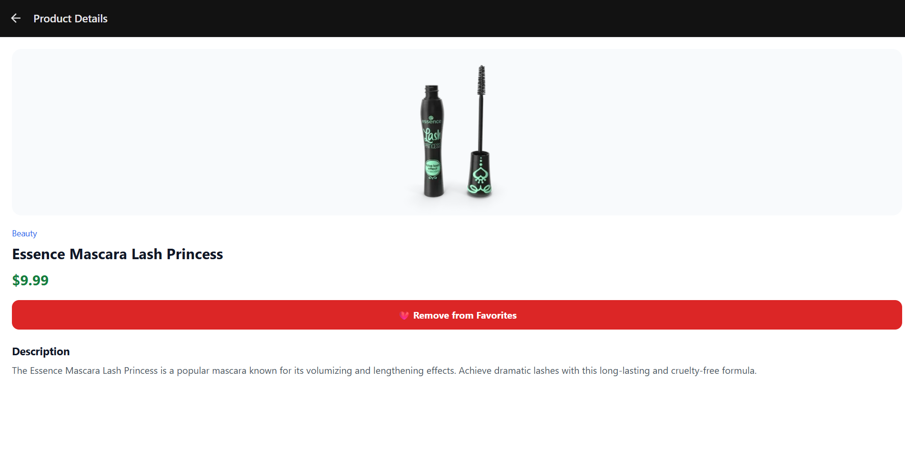

# BudgetreeProducts — React Native Product App

A product browsing application built with **React Native, Expo, and TypeScript** as part of an App Developer assignment.

## Features

- **Product Listing:** Fetches products from the DummyJSON REST API.
- **Product Cards:** Displays product images, titles, prices, and categories.
- **Search:** Search products by title.
- **Category Filter:** Filter products by category.
- **Pull to Refresh:** Reload the product list.
- **Product Details:** View product image, title, price, description, and category.
- **Favorites:** Add and remove products from favorites.
- **Persistent Storage:** Stores favorite products using AsyncStorage.
- **Loading and Error States:** Provides feedback while products load or when a request fails.
- **Navigation:** Uses Expo Router for screen navigation.

## Tech Stack

- React Native
- Expo
- TypeScript
- Expo Router
- REST API (DummyJSON)
- AsyncStorage

## API Endpoints

- Products: https://dummyjson.com/products
- Product Details: https://dummyjson.com/products/1
- Product Categories: https://dummyjson.com/products/categories

## Project Structure

```text
src/
├── app/
│   ├── _layout.tsx
│   ├── (tabs)/
│   │   ├── _layout.tsx
│   │   ├── index.tsx
│   │   ├── explore.tsx
│   │   └── favorites.tsx
│   └── product/
│       └── [id].tsx
└── components/
    └── app-tabs.tsx
```

## Getting Started

### Prerequisites

- Node.js and npm
- Expo-compatible development environment

### Installation

1. Clone the repository:

   ```bash
   git clone https://github.com/prashant9732/BudgetreeProducts.git
   ```

2. Open the project directory:

   ```bash
   cd BudgetreeProducts
   ```

3. Install dependencies:

   ```bash
   npm install
   ```

4. Start the development server:

   ```bash
   npx expo start
   ```

Follow the terminal instructions to run the app in your preferred supported environment.

## Implementation Notes

- Product data is fetched from the DummyJSON API.
- Expo Router handles navigation between the product listing, product details, and favorites screens.
- AsyncStorage persists favorite products locally on the device.
- Reusable React Native components and TypeScript types help keep the code organized.

## Repository

GitHub: https://github.com/prashant9732/BudgetreeProducts

## Screenshots

### Product Listing


### Product Details


### Favorites


---

**Developed by Prashant Verma**
